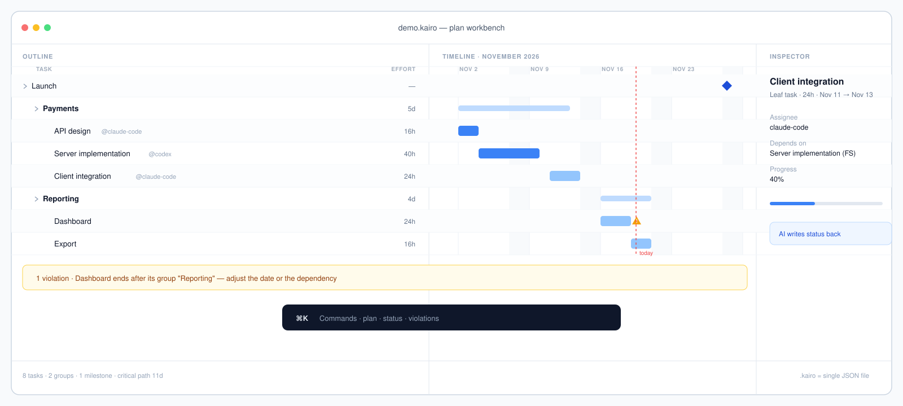
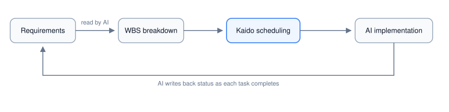

# Kaido

**English** · [简体中文](README.zh-CN.md)

> **Pronunciation** · /ˈkaɪ.roʊ/ (US) · /ˈkaɪ.rəʊ/ (UK) — “KY-roh”, the same as the city *Cairo*. Not “keh-ROH” and not “KAY-ee-roh”.

[](https://github.com/cygnusyang/Kaido/releases/latest)
[](LICENSE)
[](https://github.com/cygnusyang/Kaido/actions/workflows/ci.yml)
[](https://github.com/cygnusyang/Kaido/releases/latest)
[](Package.swift)

Project management for AI coding agents. Claude Code and Codex do the work; Kaido keeps the ledger — WBS breakdown, dependencies, scheduling and progress tracking. So "what has the AI finished, what is left, when will it land" has an answer you can check.



**[Download the macOS app](https://github.com/cygnusyang/Kaido/releases/latest)** · **[5-minute quickstart](QUICKSTART.md)** · **[Architecture](ARCHITECTURE.md)** · **[Connect an AI agent: MCP / CLI / Claude Code plugin](Plugins/README.md)**

```bash
brew install --cask cygnusyang/kaido/kaido
```


**Status: in development.** Sprint 0–3 and the ADR-013 plan-workbench redesign are complete (core model, `.kaido` persistence, scheduling engine with violation checks, status write-back, outline + timeline workbench, Claude Code plugin and deep links); 669 tests passing. Updated 2026-10-18.

## The problem

AI coding agents are good at executing a single task, but they have nothing to schedule against: the WBS, the dependencies, the dates and the status of a complex project currently live in conversation context and ad-hoc Markdown. Kaido pulls that out into its own tool and closes the loop between AI and human:



- The AI reads and writes tasks and schedules through **MCP** or the **CLI** (programmatic access is a first-class citizen);
- The human reviews the Gantt chart, violations and overall progress in the **macOS app**, and intervenes.

## Four entry points

Same capability, four equal doors. All of them read and write the same `.kaido` file (a single JSON document).

| Entry point | For | Form |
|---|---|---|
| macOS app | Humans | SwiftUI plan workbench: outline and timeline aligned row by row, inspector (task / project / violations), ⌘K command palette |
| MCP server | AI agents | stdio JSON-RPC, 16 tools |
| CLI | AI agents / scripts / terminal | Command line with parity to the MCP surface |
| Claude Code plugin | Claude Code | Slash commands `/kaido plan` / `done` / `status`, plus a `TaskCompleted` write-back hook |

> Codex and CodeBuddy do not need a plugin: use MCP plus a short convention written into `AGENTS.md` / `CODEBUDDY.md`. How to wire up all three hosts, how to break down a WBS, and every command ready to copy — see **[Plugins/README.md](Plugins/README.md)**.

## Language

The macOS app ships in English and Simplified Chinese and follows the system language. It is resolved at launch from the bundle's `CFBundleLocalizations` (`en`, `zh-Hans`) — switch the language in System Settings › General › Language & Region, then relaunch. Chinese text showing up on an English system is a bug: please report it with the screen name.

The CLI does not read the app bundle. It picks its language from `--lang <bcp47>`, then `KAIDO_LANG`, then the system locale; when the system language cannot be determined it falls back to Simplified Chinese, so existing Chinese scripts keep working. `--json` output is language-independent — identical bytes either way.

How it is built — String Catalog compiled to `.lproj` at packaging time, key grammar, CI gates — see [docs/features/06-localization.md](docs/features/06-localization.md). 中文版说明见 [README.zh-CN.md](README.zh-CN.md)。

## Running a project with an AI: how the WBS flows

The division of labour is fixed: **the human sets the boundaries, the AI breaks down and executes, Kaido keeps the books.**

```
Human: set start/end dates and acceptance criteria
 ↓
AI: task_list for the current state → break down the WBS (milestone → group → leaf) → wbs_import
 ↓
Kaido: schedule_compute → violations_list reports violations → schedule_critical_path for the critical path
 ↓
Human: review the Gantt and violations in the macOS app, approve or adjust dates/dependencies
 ↓
AI: implement task by task → status_update done → group completion aggregates weighted by effort
```

Four hard criteria for a leaf (fail any of them and it is not a leaf):

1. **Independently acceptable** — one sentence states what "done" means;
2. **One owner** — a single assignee, no parallel negotiation;
3. **0.5–3 person-days** — under half a day is over-split, over three days is under-split;
4. **Tangible output** — a file, an interface, a document, or runnable behaviour.

Every leaf needs `effortHours` (8 hours per person-day); groups and milestones carry no effort — their completion aggregates from children.

Minimal runnable example (copy and paste, swap the path for your own):

```bash
export KAIDO="$HOME/path/to/Kaido"
BIN="$KAIDO/.build/release/KaidoCLI"

"$BIN" project create "Example project" --start 2026-11-02 --end 2026-11-20 --file demo.kaido
cat > wbs.json <<'EOF'
[
  {"title": "Payments", "kind": "group", "children": [
    {"title": "API design", "effortHours": 16},
    {"title": "Server implementation", "effortHours": 40},
    {"title": "Client integration", "effortHours": 24},
    {"title": "Joint acceptance", "kind": "milestone"}
  ]}
]
EOF
"$BIN" wbs import wbs.json --file demo.kaido
"$BIN" task list --file demo.kaido                 # list tasks (add --json for scripts)

# Resolve the 4-character ID prefix by title instead of copying IDs by hand
id() { "$BIN" task list --file demo.kaido --json | python3 -c "import json,sys;print([t['id'][:4] for t in json.load(sys.stdin) if t['title']=='$1'][0])"; }

"$BIN" task update "$(id 'Server implementation')" --dep "$(id 'API design'):fs" --file demo.kaido
"$BIN" task update "$(id 'Client integration')" --dep "$(id 'Server implementation'):fs" --file demo.kaido
"$BIN" task update "$(id 'Joint acceptance')" --dep "$(id 'Client integration'):fs" --file demo.kaido
"$BIN" schedule compute --file demo.kaido          # schedule
"$BIN" schedule path --file demo.kaido             # critical path and slack
"$BIN" violations --file demo.kaido                # cycles / out of range / deadline conflicts
"$BIN" status update "$(id 'API design')" --status done --file demo.kaido  # write back each finished task
```

## Quick start

### Requirements

- Swift 5.9+ (SwiftPM)
- macOS 14+ (only needed for the macOS app and GUI tests; core, commands and presentation layers are pure Foundation and build on Linux)

### Build and test

```bash
swift build                 # debug build
swift build -c release      # release build
swift test                  # full test suite
bash tools/gate-core.sh     # core gate: KaidoCore/KaidoCommands/KaidoPresentation must not import AppKit/SwiftUI/Cocoa/Combine
bash tools/gate-ui.sh       # view gate: views must not reference Project/TaskItem/KaidoSession directly
bash tools/build.sh         # release build, packages dist/Kaido.app (also KaidoCLI / KaidoMCP)
bash tools/install.sh       # install Kaido.app into /Applications (builds first when artifacts are missing)
```

### 1. macOS app

```bash
swift run KaidoMacApp
```

It starts with an empty project (no sample data). To see it populated, choose **文件 → 载入示例项目** (File → Load Sample Project); ⌘O opens an existing `.kaido` file, ⌘S saves. Common keys:

| Action | Shortcut |
|---|---|
| Command palette | ⌘K |
| Find / next / previous | ⌘F / ⌘G / ⇧⌘G |
| Plan / outline mode | ⌥⌘1 / ⌥⌘2 |
| Focus chart / violations / today | ⌥⌘L / ⌥⌘V / ⌥⌘T |
| Indent / outdent / new sibling task | ⌘] / ⌘[ / ⌘↩ |
| New task / group / milestone | ⌘⌥N / ⌘⌥G / ⌘⌥M |

### 2. CLI

```bash
swift run KaidoCLI <command>       # abbreviated as kaido below
```

Every invocation is standalone: open the project given by `--file`, execute, save. Without `--file` it defaults to `./project.kaido`.

```bash
kaido project create "Kaido Sprint 3 demo" --file demo.kaido
kaido task add "API design" --file demo.kaido --effort 3
kaido task add "UI implementation" --file demo.kaido --effort 5 --dep <api-design-ID>:fs
kaido task list --file demo.kaido --json
kaido schedule compute --file demo.kaido
kaido violations --file demo.kaido
kaido status update <task-ID> --status done --file demo.kaido
```

Command surface:

| Group | Subcommands |
|---|---|
| `project` | `create` `open` `save` |
| `task` | `add` `list` `get` `update` `delete` |
| `wbs` | `import` |
| `schedule` | `compute` `path` |
| `violations` | (group level) |
| `status` | `update` `batch` |
| `resource` | `add` `list` |

Notes:

- Task and resource IDs accept a full UUID or a **unique prefix of at least 4 characters** (`task list --json` emits a bare array, convenient for scripting).
- Common options: `--kind` (task/group/milestone), `--parent`, `--effort`, `--duration`, `--priority`, `--status`, `--progress`, `--tags`, `--dep` (format `predecessor[:type[:lag]]`, type in fs/ff/ss/sf), `--constraint` (four kinds such as `startNoEarlierThan:2026-11-05`), `--policy` (asap/alap), `--assign` (`resourceID[:units]`), `--assignee` (owner; when working with Claude Code this can be the sub-agent name), `--json`, `--file`.
- Exit codes: `0` success / `1` runtime error / `2` usage error (missing or invalid arguments).

### 3. MCP server

```bash
.build/release/KaidoMCP        # or .build/debug/KaidoMCP
```

stdio JSON-RPC, one request per line. Use the `KAIDO_MCP_BIN` environment variable to point at the executable.

Tools: `project_create` `project_open` `project_save` `task_add` `task_list` `task_get` `task_update` `task_delete` `wbs_import` `schedule_compute` `schedule_critical_path` `violations_list` `status_update` `status_batch_update` `resource_add` `resource_list`.

### 4. Claude Code plugin

```bash
swift build -c release
export KAIDO_PROJECT=/path/to/demo.kaido
claude --plugin-dir /path/to/Kaido/Plugins/claude-code
```

| Command | Effect |
|---|---|
| `/kaido plan <requirement>` | Read the requirement, build the WBS, schedule, list violations |
| `/kaido done <task-ID>` | Mark a task done and report group completion |
| `/kaido status` | Task table, critical path and violation summary |

The plugin registers a `TaskCompleted` hook: when a Claude Code task completes it matches Kaido tasks by exact title and, on a unique hit, writes back `done` through the CLI. Negative paths (duplicate titles, zero matches, missing `KAIDO_PROJECT`) only write to stderr, never write back, and always exit 0. Environment variables: `KAIDO_PROJECT`, `KAIDO_MCP_BIN`, `KAIDO_CLI_BIN`.

See [Plugins/claude-code/README.md](Plugins/claude-code/README.md) for details.

### 5. Codex / CodeBuddy (MCP + conventions, no plugin)

Both need only an MCP config plus a short convention; the tool surface is identical to the plugin. The only cost is no automatic write-back hook: the model calls `status_update` itself per the convention instead of relying on the `TaskCompleted` event.

**Shared by Claude Code / CodeBuddy** (project-root `.mcp.json`, both hosts read it):

```bash
KAIDO="$HOME/path/to/Kaido"          # <- change to your checkout
cat > .mcp.json <<EOF
{ "mcpServers": { "kaido": { "command": "$KAIDO/.build/release/KaidoMCP" } } }
EOF
```

**Codex** (in `~/.codex/config.toml`):

```toml
[mcp_servers.kaido]
command = "/absolute/path/to/Kaido/.build/release/KaidoMCP"
args = []
```

Then drop an `AGENTS.md` at the project root (`CODEBUDDY.md` for CodeBuddy, `CLAUDE.md` for Claude Code) stating: the project file path, the breakdown order and leaf criteria, that completion must call `status_update`, and that IDs use a prefix of at least 4 characters. The exact wording can be copied from [Plugins/README.md](Plugins/README.md).

### Deep links

The app accepts `kaido://task/<full UUID or 4+ character prefix>`, `kaido://task?title=<title>` and `kaido://project/<id>`, so MCP/CLI output can hand a jump link back to a human reviewer.

### Releasing

Releasing is one command; the matching CHANGELOG section becomes the release notes verbatim:

```bash
# 1) write the "## vX.Y.Z - date" section in CHANGELOG.md first
# 2) one command: validate -> bump version -> full tests -> package -> commit -> tag -> push
tools/release.sh 0.8.3

# validate only, no commit (artifacts land in dist/, the version bump stays in the worktree)
tools/release.sh 0.8.3 --dry-run
```

Artifacts are produced by `tools/package.sh` (same script locally and in CI):

- The version inside the app bundle is checked against the tag before packaging; a mismatch fails the run.

After a tag is pushed, GitHub Actions re-runs the tests, repackages, signs the update manifest, archives the `artifacts` branch and creates the Release.

## Repository layout

```
Package.swift               SwiftPM manifest (6 targets)
Sources/KaidoCore/          Cross-platform core: model, scheduling engine, violations, queries and layout geometry (no UI dependencies)
Sources/KaidoCommands/      The single write path KaidoSession (shared by MCP/CLI/UI)
Sources/KaidoPresentation/  Platform-neutral presentation layer: snapshots, view state and actions (no UI dependencies)
Sources/KaidoMCP/           MCP server (stdio JSON-RPC)
Sources/KaidoCLI/           CLI
Apps/macos/Sources/         macOS SwiftUI workbench (WorkspaceStore adapter + views)
Plugins/README.md           AI collaboration guide: Claude Code / CodeBuddy / Codex wiring and WBS conventions
Plugins/claude-code/        Claude Code plugin (slash commands + hooks)
Tests/                      KaidoCoreTests / KaidoPresentationTests / InterfaceTests / AppTests
tools/gate-core.sh          Core and presentation layer gate
tools/gate-ui.sh            View snapshot boundary gate
tools/build.sh              Release build, packages Kaido.app
tools/install.sh            Installs Kaido.app into /Applications
design/                     Visual design: app icon, status bar icon, brand colours
docs/                       Requirements, architecture, design system, roadmap and sprint acceptance records
```

## Documentation

| Document | Purpose |
|---|---|
| [QUICKSTART.md](QUICKSTART.md) | Five minutes from install to a scheduled project |
| [ARCHITECTURE.md](ARCHITECTURE.md) | Layers, write path, data model, scheduling, interface contract (English) |
| [CONTRIBUTING.md](CONTRIBUTING.md) | Build, test, boundaries and PR expectations |
| [docs/00-vision.md](docs/00-vision.md) | Project charter, product form, G3 release bar |
| [docs/01-prd.md](docs/01-prd.md) | User stories and acceptance criteria |
| [docs/02-architecture.md](docs/02-architecture.md) | Technology choices, module boundaries, interface contracts |
| [docs/DESIGN.md](docs/DESIGN.md) | Design system: tokens, components, spacing, accessibility |
| [docs/design/ui-redesign.md](docs/design/ui-redesign.md) | Plan workbench interaction and visual spec, review log |
| [docs/03-roadmap.md](docs/03-roadmap.md) | Sprint breakdown, risk register, metrics |
| [docs/FEATURE-BREAKDOWN.md](docs/FEATURE-BREAKDOWN.md) | 175 feature specs reverse-engineered from OmniPlan (requirements input) |
| [docs/defects.md](docs/defects.md) | Defect log |
| [docs/sprint3-demo.md](docs/sprint3-demo.md) | Most recent sprint acceptance record |

## Known limitations

- Concurrent writes to the same `.kaido` from a hook and the app are not merged automatically: when the app detects an on-disk change it asks "reload / keep local", and closing the app (or reopening after write-back) is still recommended during hook write-backs.
- Drag-to-reschedule, drag-to-create-dependency, multi-select, baselines and a resource view are out of scope for now; dependencies are created from the inspector.
- Non-working time is currently only shaded for Saturday/Sunday; project and resource calendars come in a later version.
- The macOS app UI is currently Chinese only; the CLI, MCP tools and `.kaido` format are language-neutral.

## License

[PolyForm Noncommercial 1.0.0](LICENSE) — effective from v1.3.3 onward.

- **Free for noncommercial use**: personal study, hobby and private projects, research, experiment, and testing without any anticipated commercial application.
- **Free for noncommercial organizations**: charities, educational institutions, public research bodies, public safety/health organizations, environmental organizations, and government institutions — regardless of funding source.
- **Commercial use requires a commercial license**: any use with an anticipated commercial application — including using Kaido inside a for-profit company to plan your own projects — is not granted by these terms. Contact <ruohuyang@gmail.com> for terms and pricing.
- If you redistribute Kaido or a modified version, you must pass along these terms (or their URL) and any `Required Notice:` lines.
- There is no automatic conversion to an open source license. Releases up to **v1.3.2** were published under MIT and remain MIT.
- PolyForm Noncommercial is a source-available license, not an OSI-approved open source license.