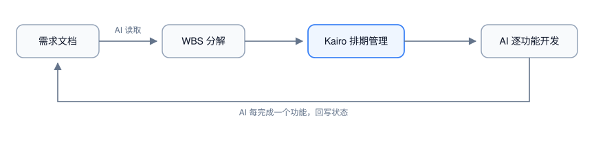

# Kairo

辅助 AI 编码智能体（Claude Code、Codex 等）开发复杂项目的项目管理软件：AI 负责执行，Kairo 负责 WBS 分解、排期、状态追踪与进度对照。

**状态：开发中。** 已完成 Sprint 0–3 与 ADR-013 计划工作台重设计（核心模型、`.kairo` 持久化、调度引擎与违例检查、状态回写、大纲与时间画布工作台、Claude Code 插件与深链）；669 项测试通过。更新：2026-10-18。

## 它解决什么问题

AI 编码智能体擅长执行单个任务，但缺少调度侧的「对照物」：复杂项目需要的 WBS、依赖关系、排期与进度状态，目前散落在对话上下文和临时 Markdown 里。Kairo 把这部分独立出来，形成 AI 与人的分工闭环：



- AI 通过 **MCP** 或 **CLI** 读写任务与排期（程序化接口是一等公民）；
- 人通过 **macOS 应用** 审阅甘特、违例与全局进度并干预。

## 四种用法

同一份能力，四个对等的入口。数据都落在同一个 `.kairo`（JSON 单文件）上。

| 入口 | 服务对象 | 形态 |
|---|---|---|
| macOS 应用 | 人 | SwiftUI 计划工作台：大纲与时间画布逐行对齐、检查器（任务/项目/违例）、⌘K 命令面板 |
| MCP 服务 | AI 智能体 | stdio JSON-RPC，16 个工具 |
| CLI | AI 智能体 / 脚本 / 终端 | 与 MCP 能力对等的命令行 |
| Claude Code 插件 | Claude Code | 斜杠命令 `/kairo plan|done|status` + `TaskCompleted` 自动回写 hook |

## 快速开始

### 环境

- Swift 5.9+（SwiftPM）
- macOS 14+（仅 macOS 应用与 GUI 测试需要；核心、命令与呈现层为纯 Foundation，可在 Linux 编译）

### 构建与测试

```bash
swift build                 # Debug 构建
swift build -c release      # Release 构建
swift test                  # 全量测试（335 项）
bash tools/gate-core.sh     # 核心门禁：KairoCore/KairoCommands/KairoPresentation 不得 import AppKit/SwiftUI/Cocoa/Combine
bash tools/gate-ui.sh       # 视图门禁：视图不直接引用 Project/TaskItem/KairoSession
bash tools/build.sh         # Release 构建并打包 dist/Kairo.app（另产出 KairoCLI / KairoMCP）
bash tools/install.sh       # 将 Kairo.app 安装到 /Applications（缺产物时会先 build）
```

### 1. macOS 应用

```bash
swift run KairoMacApp
```

启动后为空项目（无示例数据）。想看效果可选「文件 → 载入示例项目」填充一组示例任务；⌘O 打开已有 `.kairo` 文件、⌘S 保存。常用键：

| 操作 | 快捷键 |
|---|---|
| 命令面板 | ⌘K |
| 查找 / 下一处 / 上一处 | ⌘F / ⌘G / ⇧⌘G |
| 计划 / 大纲模式 | ⌥⌘1 / ⌥⌘2 |
| 聚焦图表 / 违例 / 回到今天 | ⌥⌘L / ⌥⌘V / ⌥⌘T |
| 缩进 / 减少缩进 / 新建同级任务 | ⌘] / ⌘[ / ⌘↩ |
| 新建任务 / 群组 / 里程碑 | ⌘⌥N / ⌘⌥G / ⌘⌥M |

### 2. CLI

```bash
swift run KairoCLI <命令>          # 下文简写为 kairo
```

每次调用是独立的：打开 `--file` 指定的项目 → 执行 → 保存。未指定 `--file` 时默认 `./project.kairo`。

```bash
kairo project create "Kairo Sprint 3 演示" --file demo.kairo
kairo task add "接口设计" --file demo.kairo --effort 3
kairo task add "界面开发" --file demo.kairo --effort 5 --dep <接口设计ID>:fs
kairo task list --file demo.kairo --json
kairo schedule compute --file demo.kairo
kairo violations --file demo.kairo
kairo status update <任务ID> --status done --file demo.kairo
```

命令清单：

| 组 | 子命令 |
|---|---|
| `project` | `create` `open` `save` |
| `task` | `add` `list` `get` `update` `delete` |
| `wbs` | `import` |
| `schedule` | `compute` `path` |
| `violations` | （组级） |
| `status` | `update` `batch` |
| `resource` | `add` `list` |

要点：

- 任务 ID / 资源 ID 接受完整 UUID 或 **≥4 位唯一前缀**（`task list --json` 输出裸数组，便于脚本遍历）。
- 常用选项：`--kind`（task/group/milestone）、`--parent`、`--effort`、`--duration`、`--priority`、`--status`、`--progress`、`--tags`、`--dep`（格式 `predecessor[:type[:lag]]`，type ∈ fs/ff/ss/sf）、`--constraint`（`startNoEarlierThan:2026-11-05` 等四类）、`--policy`（asap/alap）、`--assign`（`资源ID[:单位]`）、`--assignee`（负责人；与 Claude Code 协作时可填子智能体名）、`--json`、`--file`。
- 退出码：`0` 成功 / `1` 运行时错误 / `2` 用法错误（参数缺失或取值非法）。

### 3. MCP 服务

```bash
.build/release/KairoMCP        # 或 .build/debug/KairoMCP
```

stdio JSON-RPC，逐行请求。可用环境变量 `KAIRO_MCP_BIN` 指定可执行文件。

工具清单：`project_create` `project_open` `project_save` `task_add` `task_list` `task_get` `task_update` `task_delete` `wbs_import` `schedule_compute` `schedule_critical_path` `violations_list` `status_update` `status_batch_update` `resource_add` `resource_list`。

### 4. Claude Code 插件

```bash
swift build -c release
export KAIRO_PROJECT=/path/to/demo.kairo
claude --plugin-dir /path/to/Kairo/Plugins/claude-code
```

| 命令 | 作用 |
|---|---|
| `/kairo plan <需求>` | 读需求、建 WBS、排期、列违例 |
| `/kairo done <任务ID>` | 标记任务完成并回报群组完成度 |
| `/kairo status` | 任务表、重要路径与违例汇总 |

插件注册 `TaskCompleted` hook：Claude Code 任务完成时按标题精确匹配 Kairo 任务，唯一命中则经 CLI 回写 `done`。重名、0 命中、缺 `KAIRO_PROJECT` 等负路径只写 stderr 不回写，且始终以 0 退出。环境变量：`KAIRO_PROJECT`、`KAIRO_MCP_BIN`、`KAIRO_CLI_BIN`。

详见 [Plugins/claude-code/README.md](Plugins/claude-code/README.md)。

### 深链

应用支持 `kairo://task/<完整 UUID 或 ≥4 位前缀>`、`kairo://task?title=<标题>`、`kairo://project/<id>`，可在 MCP/CLI 输出中返回给人工审阅跳转。

## 目录结构

```
Package.swift               SwiftPM 清单（6 个 target）
Sources/KairoCore/          跨平台核心：模型、调度引擎、违例、查询与布局几何（零 UI 依赖）
Sources/KairoCommands/      唯一写路径 KairoSession（MCP/CLI/UI 共用）
Sources/KairoPresentation/  平台中立呈现层：快照、视图状态与动作（零 UI 依赖）
Sources/KairoMCP/           MCP 服务（stdio JSON-RPC）
Sources/KairoCLI/           CLI
Apps/macos/Sources/         macOS SwiftUI 工作台（WorkspaceStore 适配层 + 视图）
Plugins/claude-code/        Claude Code 插件（斜杠命令 + hooks）
Tests/                      KairoCoreTests / KairoPresentationTests / InterfaceTests / AppTests
tools/gate-core.sh          核心与呈现层门禁
tools/gate-ui.sh            视图快照边界门禁
tools/build.sh              Release 构建并打包 Kairo.app
tools/install.sh            安装 Kairo.app 到 /Applications
design/                     视觉设计：启动图标、状态栏图标、品牌色
docs/                       需求、架构、设计系统、路线图与 Sprint 验收记录
```

## 文档

| 文档 | 用途 |
|---|---|
| [docs/00-vision.md](docs/00-vision.md) | 项目章程、产品形态、G3 发布门槛 |
| [docs/01-prd.md](docs/01-prd.md) | 用户故事与验收判据 |
| [docs/02-architecture.md](docs/02-architecture.md) | 选型、模块边界、接口契约 |
| [docs/DESIGN.md](docs/DESIGN.md) | 设计系统：token、组件、间距、可访问性 |
| [docs/design/ui-redesign.md](docs/design/ui-redesign.md) | 计划工作台交互与视觉规格、评审登记 |
| [docs/03-roadmap.md](docs/03-roadmap.md) | Sprint 划分、风险登记簿、度量 |
| [docs/FEATURE-BREAKDOWN.md](docs/FEATURE-BREAKDOWN.md) | OmniPlan 逆向分析的 175 条功能规格（需求输入） |
| [docs/defects.md](docs/defects.md) | 缺陷登记 |
| [docs/sprint3-demo.md](docs/sprint3-demo.md) | 最近一次 Sprint 验收记录 |

## 已知限制

- hook 与应用并发写同一 `.kairo` 不自动合并：应用检测到磁盘更新会提示「重新载入 / 保留本地」，回写期间仍建议关闭应用或回写后重新打开。
- 拖条改期、拖拽建依赖、多选、基线与资源视图不在本期；依赖创建从检查器进入。
- 非工作时段目前只按周六/周日着色，项目与资源工作日历属后续版本。
