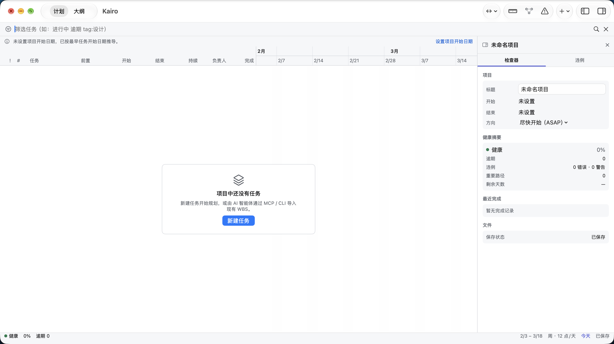
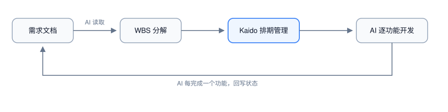

# Kaido

[English](README.md) · **简体中文**

> **发音** · /ˈkaɪ.doʊ/（美）· /ˈkaɪ.dəʊ/（英）—— 读作「凯多」；不是「凯罗」。

[](https://github.com/cygnusyang/Kaido/releases/latest)
[](LICENSE)
[](https://github.com/cygnusyang/Kaido/actions/workflows/ci.yml)
[](https://github.com/cygnusyang/Kaido/releases/latest)
[](Package.swift)

AI 编码智能体的项目管理软件。Claude Code、Codex 负责执行，Kaido 负责 WBS 分解、排期、依赖与进度对照 —— 让「AI 干到哪了、还剩什么、什么时候能完」有账可查。

> Project management for AI coding agents: WBS breakdown, dependencies, scheduling and progress tracking. AI executes, you review.



**[产品官网](https://cygnusyang.github.io/Kaido/zh.html) · [下载 macOS 应用](https://github.com/cygnusyang/Kaido/releases/latest)** · **[五分钟上手（英文）](QUICKSTART.md)** · **[架构说明（英文）](ARCHITECTURE.md)** · **[接入 AI 智能体：MCP / CLI / Claude Code 插件](Plugins/README.zh-CN.md)**

```bash
brew install --cask cygnusyang/kaidoplan/kaido
```

**最新版本：** 从 [GitHub Releases](https://github.com/cygnusyang/Kaido/releases/latest) 下载 macOS 版本，或访问 [Kaido Plan 产品官网](https://cygnusyang.github.io/Kaido/zh.html)。顶部徽章始终显示最新 tag。

## 它解决什么问题

AI 编码智能体擅长执行单个任务，但缺少调度侧的「对照物」：复杂项目需要的 WBS、依赖关系、排期与进度状态，目前散落在对话上下文和临时 Markdown 里。Kaido 把这部分独立出来，形成 AI 与人的分工闭环：



- AI 通过 **MCP** 或 **CLI** 读写任务与排期（程序化接口是一等公民）；
- 人通过 **macOS 应用** 审阅甘特、违例与全局进度并干预。

## 四种用法

同一份能力，四个对等的入口。数据都落在同一个 `.kaido`（JSON 单文件）上。

| 入口 | 服务对象 | 形态 |
|---|---|---|
| macOS 应用 | 人 | SwiftUI 计划工作台：大纲与时间画布逐行对齐、检查器（任务/项目/违例）、⌘K 命令面板 |
| MCP 服务 | AI 智能体 | stdio JSON-RPC，16 个工具 |
| CLI | AI 智能体 / 脚本 / 终端 | 与 MCP 能力对等的命令行 |
| Claude Code 插件 | Claude Code | 斜杠命令 `/kaido plan|done|status` + `TaskCompleted` 自动回写 hook |

> Codex 与 CodeBuddy 不装插件：直接用 MCP + 一段写进 `AGENTS.md` / `CODEBUDDY.md` 的约定。三个宿主怎么接、WBS 怎么拆、每条命令怎么复制，见 **[Plugins/README.zh-CN.md](Plugins/README.zh-CN.md)**。

## 语言

macOS 应用提供英文与简体中文，跟随系统语言。语言在启动时按包内 `CFBundleLocalizations`（`en`、`zh-Hans`）协商确定——在「系统设置 › 通用 › 语言与地区」切换语言后重启应用生效。英文系统下出现中文即为缺陷，请带上界面名反馈。

CLI 不读应用包：语言按 `--lang <bcp47>` → `KAIDO_LANG` → 系统语言的顺序决定；系统语言不可判定时回退简体中文，保证既有中文脚本不被破坏。`--json` 输出与语言无关，两种语言下字节一致。

实现方式（String Catalog 打包期编译成 `.lproj`、键文法、CI 门禁）见 [docs/features/06-localization.md](docs/features/06-localization.md)。English README: [README.md](README.md)。

## 和 AI 一起做项目：WBS 怎么走

分工是固定的：**人定边界，AI 拆与执行，Kaido 记账并算账。**

```
人：定起止日期与验收口径
 ↓
AI：task_list 看现状 → 拆 WBS（里程碑→群组→叶子）→ wbs_import
 ↓
Kaido：schedule_compute 排期 → violations_list 报违例 → schedule_critical_path 给重要路径
 ↓
人：在 macOS 应用看甘特与违例，批准或改期限/依赖
 ↓
AI：逐任务实现 → status_update done → 群组完成度按投入加权聚合
```

拆解的四条硬判据（不满足就不是叶子）：

1. **可独立验收**——一句话能说清「做完的标准」；
2. **单人单责**——一个负责人，不需要并行协商；
3. **0.5–3 人日**——低于半天拆过头，高于 3 天还没拆清；
4. **有明确产出物**——文件、接口、文档或可运行的行为。

叶子必须给 `effortHours`（8 小时/人日折算工期）；群组和里程碑不给投入，它们的完成度由子任务聚合。

最小可跑的一段（复制即用，路径换成自己的）：

```bash
export KAIDO="$HOME/path/to/Kaido"
BIN="$KAIDO/.build/release/KaidoCLI"

"$BIN" project create "示例项目" --start 2026-11-02 --end 2026-11-20 --file demo.kaido
cat > wbs.json <<'EOF'
[
  {"title": "支付模块", "kind": "group", "children": [
    {"title": "接口设计", "effortHours": 16},
    {"title": "服务端实现", "effortHours": 40},
    {"title": "客户端接入", "effortHours": 24},
    {"title": "联调验收", "kind": "milestone"}
  ]}
]
EOF
"$BIN" wbs import wbs.json --file demo.kaido
"$BIN" task list --file demo.kaido                 # 看清单（AI 也可直接 --json）

# 用标题取 4 位前缀，避免手抄 ID
id() { "$BIN" task list --file demo.kaido --json \
  | python3 -c "import json,sys;print([t['id'][:4] for t in json.load(sys.stdin) if t['title']=='$1'][0])"; }

"$BIN" task update "$(id 服务端实现)" --dep "$(id 接口设计):fs" --file demo.kaido
"$BIN" task update "$(id 客户端接入)" --dep "$(id 服务端实现):fs" --file demo.kaido
"$BIN" task update "$(id 联调验收)" --dep "$(id 客户端接入):fs" --file demo.kaido
"$BIN" schedule compute --file demo.kaido          # 排期
"$BIN" schedule path --file demo.kaido             # 重要路径与宽延
"$BIN" violations --file demo.kaido                # 环 / 越界 / 时限冲突
"$BIN" status update "$(id 接口设计)" --status done --file demo.kaido  # AI 完成一个回写一个
```

## 快速开始

### 环境

- Swift 5.9+（SwiftPM）
- macOS 14+（仅 macOS 应用与 GUI 测试需要；核心、命令与呈现层为纯 Foundation，可在 Linux 编译）

### 构建与测试

```bash
swift build                 # Debug 构建
swift build -c release      # Release 构建
swift test                  # 全量测试
bash tools/gate-core.sh     # 核心门禁：KaidoCore/KaidoCommands/KaidoPresentation 不得 import AppKit/SwiftUI/Cocoa/Combine
bash tools/gate-ui.sh       # 视图门禁：视图不直接引用 Project/TaskItem/KaidoSession
bash tools/build.sh         # Release 构建并打包 dist/Kaido.app（另产出 KaidoCLI / KaidoMCP）
bash tools/install.sh       # 将 Kaido.app 安装到 /Applications（缺产物时会先 build）
```

### 1. macOS 应用

```bash
swift run KaidoMacApp
```

启动后为空项目（无示例数据）。想看效果可选「文件 → 载入示例项目」填充一组示例任务；⌘O 打开已有 `.kaido` 文件、⌘S 保存。常用键：

| 操作 | 快捷键 |
|---|---|
| 命令面板 | ⌘K |
| 查找 / 下一处 / 上一处 | ⌘F / ⌘G / ⇧⌘G |
| 计划 / 大纲模式 | ⌥⌘1 / ⌥⌘2 |
| 聚焦图表 / 违例 / 回到今天 | ⌥⌘L / ⌥⌘V / ⌥⌘T |
| 缩进 / 减少缩进 / 新建同级任务 | ⌘] / ⌘[ / ⌘↩ |
| 新建任务 / 群组 / 里程碑 | ⌘⌥N / ⌘⌥G / ⌘⌥M |

### 2. CLI

```bash
swift run KaidoCLI <命令>          # 下文简写为 kaido
```

每次调用是独立的：打开 `--file` 指定的项目 → 执行 → 保存。未指定 `--file` 时默认 `./project.kaido`。

```bash
kaido project create "Kaido Sprint 3 演示" --file demo.kaido
kaido task add "接口设计" --file demo.kaido --effort 3
kaido task add "界面开发" --file demo.kaido --effort 5 --dep <接口设计ID>:fs
kaido task list --file demo.kaido --json
kaido schedule compute --file demo.kaido
kaido violations --file demo.kaido
kaido status update <任务ID> --status done --file demo.kaido
```

命令清单：

| 组 | 子命令 |
|---|---|
| `project` | `create` `open` `save` |
| `task` | `add` `list` `get` `update` `delete` |
| `wbs` | `import` |
| `schedule` | `compute` `path` |
| `violations` | （组级） |
| `status` | `update` `batch` |
| `resource` | `add` `list` |

要点：

- 任务 ID / 资源 ID 接受完整 UUID 或 **≥4 位唯一前缀**（`task list --json` 输出裸数组，便于脚本遍历）。
- 常用选项：`--kind`（task/group/milestone）、`--parent`、`--effort`、`--duration`、`--priority`、`--status`、`--progress`、`--tags`、`--dep`（格式 `predecessor[:type[:lag]]`，type ∈ fs/ff/ss/sf）、`--constraint`（`startNoEarlierThan:2026-11-05` 等四类）、`--policy`（asap/alap）、`--assign`（`资源ID[:单位]`）、`--assignee`（负责人；与 Claude Code 协作时可填子智能体名）、`--json`、`--file`。
- 退出码：`0` 成功 / `1` 运行时错误 / `2` 用法错误（参数缺失或取值非法）。

### 3. MCP 服务

```bash
.build/release/KaidoMCP        # 或 .build/debug/KaidoMCP
```

stdio JSON-RPC，逐行请求。可用环境变量 `KAIDO_MCP_BIN` 指定可执行文件。

工具清单：`project_create` `project_open` `project_save` `task_add` `task_list` `task_get` `task_update` `task_delete` `wbs_import` `schedule_compute` `schedule_critical_path` `violations_list` `status_update` `status_batch_update` `resource_add` `resource_list`。

### 4. Claude Code 插件

```bash
swift build -c release
export KAIDO_PROJECT=/path/to/demo.kaido
claude --plugin-dir /path/to/Kaido/Plugins/claude-code
```

| 命令 | 作用 |
|---|---|
| `/kaido plan <需求>` | 读需求、建 WBS、排期、列违例 |
| `/kaido done <任务ID>` | 标记任务完成并回报群组完成度 |
| `/kaido status` | 任务表、重要路径与违例汇总 |

插件注册 `TaskCompleted` hook：Claude Code 任务完成时按标题精确匹配 Kaido 任务，唯一命中则经 CLI 回写 `done`。重名、0 命中、缺 `KAIDO_PROJECT` 等负路径只写 stderr 不回写，且始终以 0 退出。环境变量：`KAIDO_PROJECT`、`KAIDO_MCP_BIN`、`KAIDO_CLI_BIN`。

详见 [Plugins/claude-code/README.md](Plugins/claude-code/README.md)。

### 5. Codex / CodeBuddy（MCP + 约定，不装插件）

两者都只需要一份 MCP 配置加一段约定，工具面与插件完全一致。唯一代价是没有自动回写 hook：任务完成由模型按约定主动调 `status_update`，不再靠 `TaskCompleted` 事件兜底。

**Claude Code / CodeBuddy 共用**（项目根 `.mcp.json`，两个宿主都读）：

```bash
KAIDO="$HOME/path/to/Kaido"          # ← 改成你的仓库路径
cat > .mcp.json <<EOF
{ "mcpServers": { "kaido": { "command": "$KAIDO/.build/release/KaidoMCP" } } }
EOF
```

**Codex**（写入 `~/.codex/config.toml`）：

```toml
[mcp_servers.kaido]
command = "/absolute/path/to/Kaido/.build/release/KaidoMCP"
args = []
```

再在项目根放 `AGENTS.md`（CodeBuddy 用 `CODEBUDDY.md`、Claude Code 用 `CLAUDE.md`），写明：项目文件路径、拆解顺序与叶子判据、完成必须 `status_update`、ID 用 ≥4 位前缀。这段约定的原文可直接复制自 [Plugins/README.zh-CN.md §3](Plugins/README.zh-CN.md)。

### 深链

应用支持 `kaido://task/<完整 UUID 或 ≥4 位前缀>`、`kaido://task?title=<标题>`、`kaido://project/<id>`，可在 MCP/CLI 输出中返回给人工审阅跳转。

### 发版

发版只需要一条命令，CHANGELOG 的对应章节会被直接用作 Release 说明：

```bash
# 1) 先在 CHANGELOG.md 写好「## vX.Y.Z — 日期」章节
# 2) 一条命令走完：校验 → 改版本号 → 全量测试 → 打包 → 提交 → tag → 推送
tools/release.sh 0.8.3

# 只验证不提交（产物在 dist/，版本号会留在工作区）
tools/release.sh 0.8.3 --dry-run
```

产物由 `tools/package.sh` 生成（本地与 CI 同源）：

```bash
tools/package.sh v0.8.3            # 构建 + 打包，产出 dist/Kaido-v0.8.3.{dmg,zip}
tools/package.sh v0.8.3 --skip-build --out /tmp/out
```

- `Kaido-vX.Y.Z.dmg`：人装，挂载后拖入 Applications；
- `Kaido-vX.Y.Z.zip`：OTA 载体（ditto 保留签名），配 `update-manifest.json` 使用；
- 打包前会校验应用内版本号等于 tag，不一致直接失败。

推送 tag 后 GitHub Actions 复跑测试、重新打包、签名更新清单、归档 `artifacts` 分支并创建 Release。

## 目录结构

```
Package.swift               SwiftPM 清单（6 个 target）
Sources/KaidoCore/          跨平台核心：模型、调度引擎、违例、查询与布局几何（零 UI 依赖）
Sources/KaidoCommands/      唯一写路径 KaidoSession（MCP/CLI/UI 共用）
Sources/KaidoPresentation/  平台中立呈现层：快照、视图状态与动作（零 UI 依赖）
Sources/KaidoMCP/           MCP 服务（stdio JSON-RPC）
Sources/KaidoCLI/           CLI
Apps/macos/Sources/         macOS SwiftUI 工作台（WorkspaceStore 适配层 + 视图）
Plugins/README.zh-CN.md  AI 协作指南（中文）：Claude Code / CodeBuddy / Codex 接法与 WBS 拆解规程
Plugins/claude-code/        Claude Code 插件（斜杠命令 + hooks）
Tests/                      KaidoCoreTests / KaidoPresentationTests / InterfaceTests / AppTests
tools/gate-core.sh          核心与呈现层门禁
tools/gate-ui.sh            视图快照边界门禁
tools/build.sh              Release 构建并打包 Kaido.app
tools/install.sh            安装 Kaido.app 到 /Applications
design/                     视觉设计：启动图标、状态栏图标、品牌色
docs/                       需求、架构、设计系统、路线图与 Sprint 验收记录
```

## 文档

| 文档 | 用途 |
|---|---|
| [docs/00-vision.md](docs/00-vision.md) | 项目章程、产品形态、G3 发布门槛 |
| [docs/01-prd.md](docs/01-prd.md) | 用户故事与验收判据 |
| [docs/02-architecture.md](docs/02-architecture.md) | 选型、模块边界、接口契约 |
| [docs/DESIGN.md](docs/DESIGN.md) | 设计系统：token、组件、间距、可访问性 |
| [docs/design/ui-redesign.md](docs/design/ui-redesign.md) | 计划工作台交互与视觉规格、评审登记 |
| [docs/03-roadmap.md](docs/03-roadmap.md) | Sprint 划分、风险登记簿、度量 |
| [docs/FEATURE-BREAKDOWN.md](docs/FEATURE-BREAKDOWN.md) | OmniPlan 逆向分析的 175 条功能规格（需求输入） |
| [docs/defects.md](docs/defects.md) | 缺陷登记 |
| [docs/sprint3-demo.md](docs/sprint3-demo.md) | 最近一次 Sprint 验收记录 |

## 已知限制

- hook 与应用并发写同一 `.kaido` 不自动合并：应用检测到磁盘更新会提示「重新载入 / 保留本地」，回写期间仍建议关闭应用或回写后重新打开。
- 拖条改期、拖拽建依赖、多选、基线与资源视图不在本期；依赖创建从检查器进入。
- 非工作时段目前只按周六/周日着色，项目与资源工作日历属后续版本。

## 许可证

自 v1.3.3 起采用双许可路线：[PolyForm Noncommercial 1.0.0](LICENSE) 适用于符合条件的非商业使用；商业使用须另行取得书面商业授权。许可概览见 [Kaido Plan 产品官网](https://cygnusyang.github.io/Kaido/zh.html#license)。

- **非商业使用免费**：个人学习、爱好与私人项目、科研、实验与测试，且不预期任何商业应用。
- **非商业组织免费**：慈善机构、教育机构、公共研究机构、公共安全或卫生机构、环保组织、政府机构，不论资金来源。
- **商业使用需购买商业授权**：任何预期商业应用的场景（包括在营利公司内部用 Kaido 管自己的项目）都不在本许可范围内，请通过 [ruohuyang@163.com](mailto:ruohuyang@163.com?subject=Kaido%20Commercial%20License) 联系申请单独的书面授权。授权范围与报价由双方书面确认；联系邮箱本身不构成授权。
- 再分发 Kaido 或其修改版本时，必须一并传递本许可条款（或链接）以及所有 `Required Notice:` 行。
- **没有**自动转开源条款；**v1.3.2 及以前**的版本按 MIT 发布，该授权继续有效。
- PolyForm Noncommercial 属于「源码可得」（source-available），不是 OSI 认证的开源许可。
