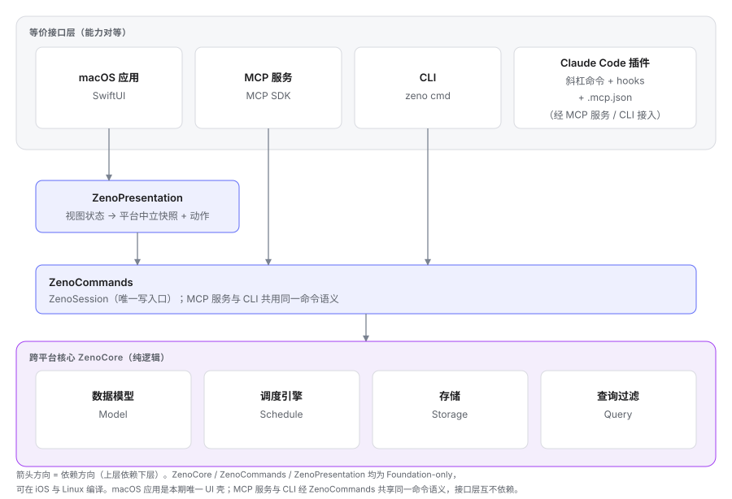
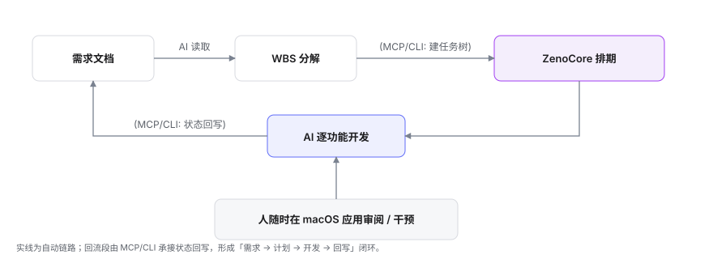
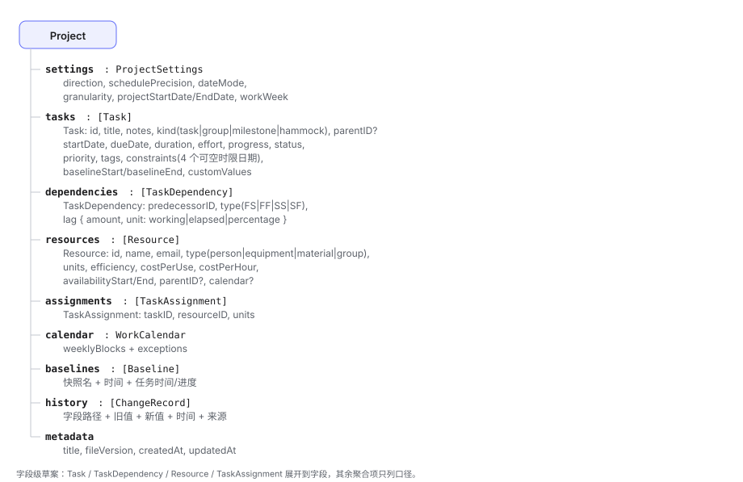
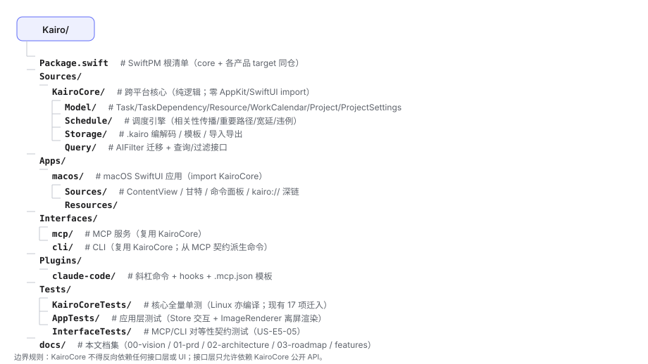
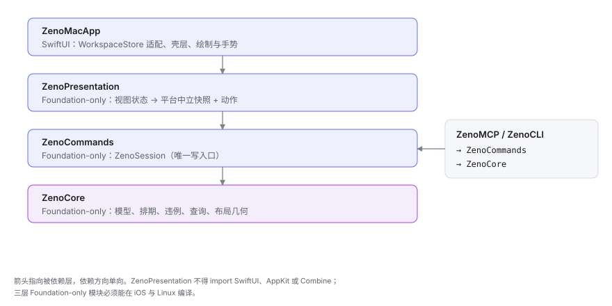

# Kaido 架构决策文档（Architecture）

> 版本 0.1 · 2026-10-17 · 状态：已接受（Sprint 0 产出，待评审）
> 上游依据：[00-vision.md](00-vision.md)（跨平台核心 + 等价接口层）、[01-prd.md](01-prd.md)（需求）、[04-glossary.md](features/04-glossary.md)（术语）
> 范围：核心与接口层的总体架构、技术选型、接口契约草案、数据模型、目录结构、ADR。不含实现代码；接口示意（MCP 工具、CLI 用法）允许给出。

## 1. 总体架构

### 1.1 分层图



核心（KaidoCore）承载全部业务逻辑：数据模型、调度引擎、存储、查询过滤；接口层（macOS 应用、MCP 服务、CLI、Claude Code 插件）互不依赖、能力对等，只复用核心。该结构对应 vision §4 与 G3 判据。

Sprint 4 起，UI 与命令层之间加入 `KaidoPresentation`（Foundation-only）：视图状态与核心数据经纯函数生成平台中立快照，视图只消费快照并发出动作。分层与写路径见 [ADR-013](#adr-013-呈现层与唯一写路径sprint-4)。

### 1.2 数据流（核心闭环，vision §3）



## 2. 核心技术选型

**关键约束**（vision §5）：核心必须跨平台（macOS/Windows/Linux）、必须能被 Swift macOS 应用嵌入、必须能被 MCP 服务与 CLI 复用。候选方案三个，按四维评估。

### 2.1 候选方案

#### (a) Rust 核心 + FFI（Swift/Node 绑定）

- **跨平台成熟度**：高。Rust 官方一等支持三大平台；`no_std` 可选，内存安全，性能上限最高。
- **与 SwiftUI macOS 应用集成成本**：中高。需要 FFI 桥：C ABI 头文件（`cbindgen`）或绑定生成器（`uniffi` / `swift-bridge`）；Swift 侧维护类型映射与错误桥接，调试跨语言边界成本高。
- **MCP SDK 生态**：官方 `rust-sdk`（modelcontextprotocol 组织维护），成熟度较高。
- **长期维护**：需要双语言团队（Rust + Swift），FFI 层随模型演进持续维护。
- **结论**：性能与可移植性最强，但 MVP 期集成成本最高，闭环验证最慢。

#### (b) TypeScript/Node 核心（Electron/Tauri）

- **跨平台成熟度**：高。Node 一等支持三大平台。
- **与 SwiftUI macOS 应用集成成本**：高。若保留纯 SwiftUI，须在应用内嵌 Node 运行时或通过进程间通信（本地 HTTP/socket）调用 Node 核心——桥复杂且脆弱；若转向 Tauri，放弃纯 SwiftUI，需重写 UI，违背「macOS 应用原生体验」定位（vision §4）。
- **MCP SDK 生态**：最强。官方 `@modelcontextprotocol/sdk`（TypeScript）最成熟。
- **长期维护**：TS 生态大，但语言边界（Node 核心 + Swift UI）长期并存，类型与数据契约维护成本高。
- **结论**：MCP 生态最优，但「必须被 Swift macOS 应用嵌入」是硬伤，放弃纯 SwiftUI 代价不可接受。

#### (c) Swift 核心（SwiftPM 跨平台包）

- **跨平台成熟度**：中。Linux 为 Swift 官方支持平台（Swift.org 发布 Linux 工具链，Foundation/JSON/Codable 可用）；Windows 为官方提供但属社区维护级别（Swift 5.9+ 可构建，Foundation 部分功能受限）。需如实评估：核心只依赖 Foundation 子集时，Linux 编译可行、Windows 编译可行但有风险。
- **与 SwiftUI macOS 应用集成成本**：最低。同一语言同一工具链，macOS 应用直接 `import KaidoCore`，零桥接，调试无语言边界。
- **MCP SDK 生态**：早期。Swift MCP SDK 有官方/社区实现（如 `swift-mcp`、`mcp-swift`），活跃度低于 TS/Rust，需在 Sprint 1 前复核。
- **长期维护**：单一语言单一代码库，模型、调度、UI 同步演进，维护成本最低；跨平台仅需关注 Foundation 子集的可移植性。
- **结论**：与 SwiftUI 集成零成本、闭环验证最快，跨平台可满足 G3（Linux 编译），Windows 为风险项（本期不承诺）。

### 2.2 推荐（阶段策略）

**MVP 期（Sprint 1–5）：采用方案 (c) Swift 核心。**

- 立即被 SwiftUI macOS 应用嵌入，零集成成本；
- 单一语言让 Sprint 0→1 最快见到「建 WBS → 排期 → 回写」全闭环 demo；
- macOS 是 G3 第一交付目标（vision §5），Linux 编译为 G3 判据 4，Swift 核心在 Linux 编译可行；
- MCP 生态不足是唯一实质短板，但 MVP 工具面可控（20 个工具以内），社区 SDK 可支撑，必要时可用最小自实现 MCP 传输。

**Phase 2（MVP 验收后）：评估迁移方案 (a) Rust。**

- 触发条件：出现 Linux/Windows 发行需求、调度引擎成为性能瓶颈、或 Swift MCP SDK 长期不满足接口需求；
- 迁移策略：KaidoCore 从一开始按模块边界隔离（数据模型/调度引擎/存储均以协议与纯数据结构表达），保持「纯逻辑可移植子集」——若迁移，只迁该子集，UI 与接口层不变；
- 方案 (b) 维持否决：放弃纯 SwiftUI 的代价不可接受。

**约束（本决策的落地要求）**：KaidoCore 只依赖 Foundation 子集（Codable、Date、JSON、集合），不得 import AppKit/SwiftUI、Combine 等平台绑定框架（ADR-004）；该约束同时在 Sprint 0 重构 KaidoCore 时用编译门禁验证。

## 3. 接口层设计（契约草案）

### 3.1 MCP 工具清单草案

以下为接口事实源（US-E5-05：CLI 与插件从本清单派生）。工具名、输入、输出为契约草案，Sprint 1 复核后定稿。

已实装工具（Sprint 2 定稿，16 个）：

| 工具名 | 输入（要点） | 输出 | 覆盖 US |
|---|---|---|---|
| `project_create` | `title`, `projectStart?`, `projectEnd?` | 项目元数据 + `formatVersion`（恒为当前版本） | US-E1-01 |
| `project_open` | `path` | 项目元数据 + `formatVersion`（磁盘文件版本）、`currentFormatVersion`、`needsUpgrade` | US-E6-01 |
| `project_save` | `path?` | `savedAt`, `path`, `formatVersion`（写出文件版本）、`upgradedFrom?`（来源早于当前版本时） | US-E6-01 |
| `task_add` | `title`, `kind?`, `parentID?`, `effortHours?`, `durationDays?`, `notes?`, `priority?`, `status?`, `tags?`, `dependencies?`, `constraint?`, `schedulingPolicy?`, `assignments?` | `taskID` | US-E1-02/03/05、US-E2-01 |
| `task_list` | `parentID?`, `filter?` | `[TaskItem]` | US-E4-01 |
| `task_get` | `taskID` | `TaskItem` | US-E4-01 |
| `task_update` | `taskID` + 可变字段（含 `dependencies` / `constraint` / `schedulingPolicy` / `assignments`） | `TaskItem` | US-E1-02、US-E2-01 |
| `task_delete` | `taskID` | `ok`（级联删除全部子任务） | US-E1-02 |
| `wbs_import` | `nodes`（嵌套任务树） | `rootIDs`, `total`, `warnings` | US-E1-04 |
| `schedule_compute` | `projectStart?`, `projectEnd?`（缺省用项目时间线） | 每任务最早/最晚/选定安排与宽延 | US-E2-02 |
| `schedule_critical_path` | `slackLimit?` | 宽延明细与 `isCritical` | US-E2-03 |
| `violations_list` | — | `[Violation]`（类型/涉及任务/原因） | US-E2-05 |
| `status_update` | `taskID`, `status?`, `progress?` | `TaskItem` + `groupProgress` | US-E3-01/02 |
| `status_batch_update` | `tasks: [{taskID, status?, progress?}]` | 逐条成功/失败明细 | US-E3-02 |
| `resource_add` | `name`, `kind?`, `units?`, `efficiency?` | `resourceID` | US-E1-05 |
| `resource_list` | — | `[Resource]` | US-E1-05 |

`dependencies` 元素为 `{"predecessorID":"UUID","type":"fs","lagDays":0}`；`constraint` 为
`type:ISO8601`。工具清单以 `Sources/KaidoMCP/Tools.swift` 为唯一事实源（ADR-005），
CLI 从同一命令层派生。

后续规划工具（尚未实装）：`project_summary`、`dependency_add` / `dependency_remove` /
`dependency_list`（当前经 `task_add` / `task_update` 的 `dependencies` 参数完成）、
`schedule_rearrange`、`resource_assign`、`report`。

**错误契约**：所有工具失败时返回结构化错误（`{ code, message, taskID? }`），不得抛未捕获异常；非法参数（如进度 > 1、任务不存在）返回参数错误码。

### 3.2 CLI 命令清单草案

动词与 MCP 工具对等（G3 判据 2）。输出默认人类可读，`--json` 时输出结构化数据（Sprint 3 先在 `task list` 落地，其余命令按需扩展）。

```
kaido project open|create|save|summary <path> [--title] [--direction] [--precision]
kaido task add <title> [--kind task|group|milestone] [--parent <id>] [--due <date>] [--priority] [--effort] [--notes] [--assignee <名字>]
kaido task list [--filter "<自然语言>"] [--parent <id>] [--json]
kaido task get <id>
kaido task update <id> [--title] [--status] [--priority] [--progress] [--due] [--assignee <名字>]
kaido task delete <id>                  # 连同全部子任务一并删除
kaido wbs import -f <file.json|file.md> [--report]
kaido dep add <taskID> --predecessor <id> [--type FS|FF|SS|SF] [--lag <expr>]
kaido dep remove <taskID> --predecessor <id>
kaido dep list <taskID>
kaido schedule compute
kaido schedule query [<taskID>]
kaido schedule critical-path
kaido status set <id> [--status] [--progress] [--done]
kaido status batch -f <file.json>
kaido violations
kaido resource add <name> [--type person|equipment|material] [--units] [--efficiency]
kaido resource assign <taskID> --resource <id> [--units]
kaido report [--format markdown]
kaido export <csv|json|markdown> [-o <path>]
kaido import <csv> [--report]
kaido schema > kaido.schema.json
kaido version
```

### 3.3 Claude Code 插件构成

插件是 MCP 的便捷封装，不新增能力（保持接口对等）。当前实装位于 `Plugins/claude-code/`：

1. **斜杠命令**（`commands/`）：
   - `/kaido plan <需求>`：读需求 → `wbs_import` → `schedule_compute` → `violations_list`；
   - `/kaido done <任务ID>`：`status_update` 置完成并回报群组完成度；
   - `/kaido status`：`task_list` + 排期 + 重要路径 + 违例汇总。
2. **hooks**：尚未配置。Claude Code 任务工具与 Kaido 任务之间没有 ID 映射，
   自动检测完成信号会误写；完成回写当前由 `/kaido done` 显式触发。
3. **`.mcp.json`**：插件根目录提供，`command` 指向 `bin/kaido-mcp` 启动脚本；
   脚本依次尝试 `KAIDO_MCP_BIN`、`.build/release/KaidoMCP`、`.build/debug/KaidoMCP`。
   MCP 服务不接收启动参数，项目由会话内 `project_open` 打开。

插件清单与命令由 `claude plugin validate Plugins/claude-code` 校验。

### 3.4 macOS 应用层构成（Sprint 3）

> 本小节记录 Sprint 3 的实现状态。Sprint 4 UI 重设计以 [ADR-013](#adr-013-呈现层与唯一写路径sprint-4) 为准：`ProjectStore` 由 `WorkspaceStore` 取代；`ContentView`、`GanttView` 拆分为大纲、时间画布与检查器组件；所有写入经 `KaidoSession`。

应用层只做呈现与交互，业务判断全部下沉到 KaidoCore 纯函数：

| 组件 | 职责 |
|---|---|
| `ProjectStore` | 应用门面：包装 `KaidoSession`，把项目、排期、违例镜像为 `@Published`；承载选中项、视图模式、面板开关 |
| `ContentView` | 大纲/甘特切换、检查器、违例面板、查找栏与 ⌘K 面板挂载 |
| `GanttView` | 绘制甘特并处理拖动标头平移、缩放菜单；几何来自 `GanttLayoutEngine` |
| `CommandRegistry` / `CommandPalette` | 单一命令注册表（菜单栏与 ⌘K 面板同源，US-E4-05） |
| 核心纯函数 | `GanttLayoutEngine`（布局几何/刻度/非工作带）、`OutlineEditor`（缩进/出缩进/新建同级）、`KaidoDeepLink`（深链解析） |

非工作时段着色当前按周六、周日显示；工作日历模型（F-22-06）落地后改为读取项目/资源日历。

**`body` 拆分规则**：`body` 只做组合，不内联成串的工具栏项与行视图。工具栏项超过 3 个或 `body` 超过 40 行时，必须拆为计算属性或独立的 `@ToolbarContentBuilder`。Swift 类型检查器对长视图表达式会超时，拆分是为了可编译，不是为了美观（Sprint 3 回顾 A2）。

## 4. 数据模型

### 4.1 实体关系



要点：

- **相关性** 从 `TaskItem.dependencies: [UUID]` 重构为 `[TaskDependency]`（带类型与前导时间），旧数据按「FS、无前导时间」迁移（US-E2-01 验收）；
- **时间换算** 遵循规格：`duration = effort / Σ(units×efficiency)`（[F-22-03](features/02-inspectors-scheduling.md)）；
- **群组聚合**：投入 = 子任务投入之和；持续时间 = 首任务开始至末任务结束的跨度；完成度 = 已完成投入 /（已完成 + 剩余）投入（[F-14-04](features/01-views-editing.md)、[F-20-03](features/02-inspectors-scheduling.md)）；
- **版本历史**（`ChangeRecord`）为字段级追加日志，支撑撤销与冲突差异说明（US-E3-04/05）。

### 4.2 单文件项目格式（.kaido）草案

`.kaido` 为单一 JSON 文件（本地优先，F-34-01）。草案 schema：

```json
{
  "fileVersion": 1,
  "title": "示例项目",
  "settings": {
    "direction": "forward",
    "schedulePrecision": "day",
    "dateMode": "specific",
    "projectStartDate": "2026-11-02",
    "workWeek": { "weeklyBlocks": [ { "day": 1, "start": "09:00", "end": "18:00" } ] }
  },
  "tasks": [
    { "id": "uuid-a", "title": "实现搜索后端", "kind": "task", "parentID": null,
      "startDate": "2026-11-02", "dueDate": "2026-11-06",
      "duration": 28800, "effort": 28800, "progress": 0, "status": "pending",
      "priority": "critical", "tags": ["后端"], "notes": "",
      "constraints": {}, "assignments": [] }
  ],
  "dependencies": [
    { "taskID": "uuid-b", "predecessorID": "uuid-a", "type": "FS",
      "lag": { "amount": 0, "unit": "working" } }
  ],
  "resources": [ { "id": "uuid-r", "name": "Alice", "type": "person",
    "units": 1.0, "efficiency": 1.0 } ],
  "calendar": { "weeklyBlocks": [ { "day": 1, "start": "09:00", "end": "18:00" } ],
    "exceptions": [ { "date": "2026-11-05", "kind": "rest" } ] },
  "baselines": [],
  "history": [],
  "createdAt": "2026-10-17T00:00:00Z",
  "updatedAt": "2026-10-17T00:00:00Z"
}
```

约定：文件必须可被 git/云盘直接版本管理；打开时校验 `fileVersion`，不兼容版本返回明确错误且不覆盖原文件（US-E6-01 验收）。

## 5. 目录结构规划（monorepo）

现有 `Sources/Kaido/`（单 target）重构为「核心 + 产品」多 target。macOS 应用迁入 `Apps/macos/`。



边界规则：KaidoCore 不得反向依赖任何接口层或 UI；接口层只允许依赖 KaidoCore 公开 API；`Plugins/claude-code` 为配置与提示词，不含核心逻辑。

## 6. ADR 风格决策记录

| 编号 | 决策 | 状态 | 理由 |
|---|---|---|---|
| ADR-001 | 架构：跨平台核心 + 等价接口层 | 已接受 | vision §4；MCP/CLI/应用同等重要，为 Windows/Linux/iOS/Android 留扩展位 |
| ADR-002 | 核心语言：MVP 期 Swift（SwiftPM 包），Phase 2 评估 Rust 迁移 | 已接受 | Swift 与 SwiftUI 零成本集成、单语言闭环最快；Linux 官方支持满足 G3；Windows 仅社区级，本期不承诺 |
| ADR-003 | 持久化：单文件 `.kaido`（JSON），本地优先 | 已接受 | F-34-01；天然兼容云盘与 git，无账号/无服务器（vision §6） |
| ADR-004 | 核心层零 UI 依赖（只依赖 Foundation 子集） | 已接受 | 可测试性 NFR-7/8；可移植性；Linux 编译（G3 判据 4） |
| ADR-005 | 接口契约：MCP 工具清单为单一事实源，CLI/插件同源派生 | 已接受 | 接口对等（G3 判据 2）；防漂移（US-E5-05） |
| ADR-006 | 协作：无服务器/账号，同步委托文件同步渠道 + AI 差异合并 | 已接受 | F-35-01/04/05；AI 时代减负；本期不做多用户实时协作 |
| ADR-007 | 调度引擎与违例引擎分离，调度为纯函数 | 提议 | 可测试性（NFR-8）；F-30 规则集可增量落地 |
| ADR-008 | 报告走 AI 叙述式 Markdown，不做 HTML 模板引擎 | 已接受 | F-33-05/07；AI 时代口径，报告直接进知识库/Obsidian 流水线 |
| ADR-009 | 现有 `assignee: String?` 迁移为资源分配（`TaskAssignment`），保留便捷显示 | 已接受 | 04-glossary「分配」；F-22-08/F-23-01；迁移兼容 |
| ADR-010 | MVP 期自实现最小 stdio JSON-RPC（零第三方依赖，仅 initialize/tools 列表/工具调用 三组方法），Phase 2 复核官方 Swift MCP SDK | 已接受 | 2026-10-17 lead 裁定；协议面小可全量测试，消除 SDK 演进风险；接口契约（ADR-005）不受影响 |
| ADR-012 | 嵌套可选结构（如 WBSNode.children）一律自定义 `init(from:)`，禁用合成 Codable 的必填语义 | 已接受 | Sprint 1 回顾 P3；叶子节点解码失败教训 |
| ADR-011 | `.kaido` 读写兼容规则：文件携带 `formatVersion`；读取忽略未知字段（前向兼容）；字段只增不改语义；读取 1…current 并按序迁移，拒绝更高版本；保存恒写 current | 已接受 | 2026-10-17 lead 裁定，2026-10-20 补充迁移策略；JSON 人工可读、AI 可写、git 友好（ADR-003 补充） |
| ADR-013 | 引入 Foundation-only 呈现层 `KaidoPresentation`：视图只消费 `WorkspaceSnapshot` 并发出 `WorkspaceAction`；所有写入经 `KaidoSession` 唯一写路径；排期缓存按写置脏、按读重算 | 已接受 | 2026-10-18 lead 裁定；UI 与 MCP/CLI 语义同源；快照边界支撑多平台与可测试性。详见 §6.1 |

### ADR-013 呈现层与唯一写路径（Sprint 4）

分层：



依赖方向单向。`KaidoPresentation` 不得 import SwiftUI、AppKit 或 Combine。`KaidoCore`、`KaidoCommands`、`KaidoPresentation` 必须能在 iOS 与 Linux 编译；macOS 应用仍是本期唯一 UI 壳。

决策：

1. **快照边界**：视图不读 `Project`、不绑定 `TaskItem`。视图只接收 `WorkspaceSnapshot` 并发出 `WorkspaceAction`。
2. **唯一写路径**：所有变更经 `KaidoSession`。UI 不得直接调用 `Project.add/update/remove`。MCP、CLI 与 UI 使用同一命令语义。
3. **排期缓存**：会话的每个写方法置脏；读取排期时按需重算一次。UI 不自行重算排期。
4. **项目时间线缺失**（D-003）：`ScheduleEngine` 按「最早任务 `startDate` → 今天」推导锚点，并在结果中记录 `projectStartDerived`。界面显示推导提示与「设置项目开始日期」入口，禁止从 1970 年起排。该推导只决定时间轴原点，不固定任务自身开始。
5. **行对齐与画布分层**：计划模式使用单一纵向滚动容器加 `LazyVStack` 提供行骨架；时间画布使用一个与内容等高、宽度为画布视口的 `Canvas` 叠加层统一绘制。禁止两个独立滚动视图用偏移同步。
6. **撤销**：应用层维护快照式撤销栈（`ProjectState`，50 步，连续输入 500ms 合并）。撤销记录同时保存选择与展开集合；恢复后校验目标仍存在，缺失则回项目页。
7. **日期语义**：`startDate` 是用户意图 + 排期下界——前向传播把显式 `startDate`（日粒度归一为当天零点）与项目锚点、时限下界、相关性下界取较晚者作为「开始不早于」，即它不驱动任务提前，但排期结果不得早于该日（群组忽略自身 `startDate`，由子任务聚合；里程碑同样适用）；后向传播（最晚开始/结束、宽延）口径不变；`dueDate` 是截止日期，只用于风险提示与时限窗口，不驱动排期。逾期口径为「计划结束 < 今天且未完成」，无排期时退回 `dueDate`；截止风险口径为「`dueDate` 存在且计划结束 > `dueDate` 且未完成」。
8. **外部更新**：应用前台每 2 秒比较 `.kaido` 的 mtime。会话维护 `hasUnsavedChanges`；保存后清除并记录自身写入的 mtime。用户选择「保留本地」后记录已确认的 mtime，文件再次变化才重新提示。本期不做差异比较与自动合并。

核心层新增：

- `ProjectSummary`：加权总进度、任务/群组/里程碑计数、逾期数、error/warning 计数、重要路径数、剩余天数、健康点。健康占比的分母固定为未完成叶子任务。
- `OutlineTree`：过滤、展开、同级排序、祖先保留、群组聚合。聚合始终基于全量子树；过滤只影响可见性。
- `OutlineMoving`：拖拽重排的目标父级与索引计算，拒绝拖入自身或后代。
- `DependencyEditing`：四型 CRUD、环校验、重复归一、删除时清理悬空引用。
- `ProjectState`：`{metadata, tasks, resources}` 值快照，供撤销与恢复。
- `ScheduleAnchor`：项目开始锚点推导与 `projectStartDerived` 标记。
- `ScheduleResult.unscheduledTaskIDs`：依赖环、空群组等无法排期的任务；`hasSchedule` 为存在有效排期且不在该集合。
- `ProjectMetadata.direction`：默认 `.forward`；按 ADR-011/ADR-012 写自定义 `init(from:)` 与 `decodeIfPresent`，旧文件缺省为 forward。
- `ViolationEngine.ruleCategories`：规则目录（代码、名称、severity），违例页空态与检查器共用。
- `KaidoSession` 字段更新使用显式 patch 语义（unchanged / set / clear）；`dueDate`、`assignee` 可被清空；状态、进度与 `completedAt` 走统一状态回写入口。

不变量：

- 界面显示的计数、健康点与违例必须来自同一核心计算结果。
- 快照类型不携带颜色、字号或任何视觉 token。
- 视图文件的模型引用由 `tools/gate-ui.sh` 按词边界检查；`WorkspaceStore` 为唯一允许的适配层。

## 7. 已确认决策（2026-10-17 lead 裁定）

1. MCP SDK：自实现最小 stdio JSON-RPC（ADR-010）；官方 SDK 移入 Phase 2 复核清单。
2. Linux CI：GitHub Actions `ubuntu-latest` + 官方 `swift:6.x` 容器镜像，Sprint 2 起作为构建门禁（R1 缓解措施）。
3. `.kaido` 格式与兼容：JSON + `formatVersion` + 未知字段忽略（ADR-011）。
4. monorepo 重构边界：按本文档 §5 结构一次性迁移，Sprint 0 单次原子提交；`Apps/`、`Interfaces/`、`Plugins/` 大写目录名以本节为准。

> 原「待确认」条目全部落定，遗留跟踪项见 03-roadmap 风险登记簿。问题

1. **Swift MCP SDK**：选择官方还是社区维护的 SDK，需在 Sprint 1 复核活跃度；若不足，可自实现最小 MCP JSON-RPC 传输（工具面小、成本可控）。
2. **Linux CI**：Swift Linux 工具链版本与镜像需在 Sprint 0 确认（见 [03-roadmap.md](03-roadmap.md) 风险 R1）。
3. **`.kaido` 向后兼容策略**：已于 2026-10-20 定稿——读取 1…current 并顺序迁移，拒绝更高版本；保存恒写 current（ADR-011）。
4. **monorepo 与现有仓库关系**：重构 `Sources/Kaido/` → `KaidoCore` 的动作是否独立提交、是否保留旧 tag，需在 Sprint 0 计划会确认。
